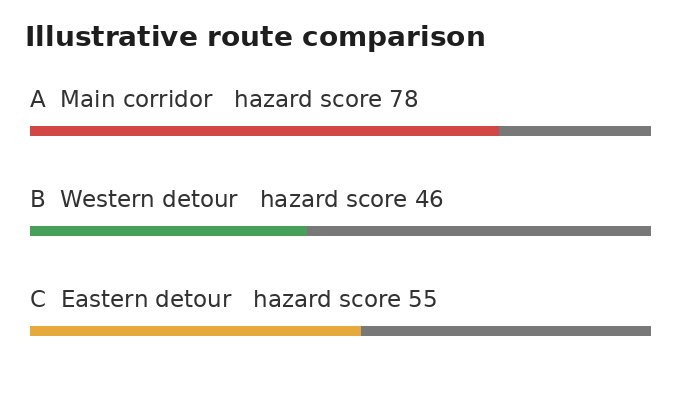
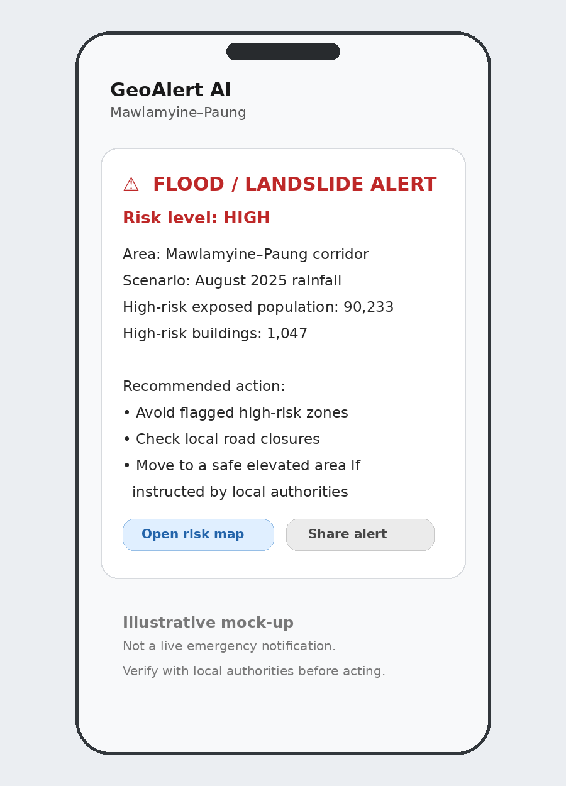

# 🌐 GeoAlert AI

**Telecom Network Resilience for Flood & Landslide Early Warning**  
*Mawlamyine–Paung Corridor, Mon State, Myanmar*

[](https://python.org/)
[](https://streamlit.io/)
[](https://deckgl.readthedocs.io/)
[](https://qgis.org/)
[](https://networkx.org/)
[](https://www.openstreetmap.org/)

---

## 📸 Prototype Previews

<div align="center">

| **Risk-Weighted Road Routing (NetworkX Dijkstra)** | **Telegram Early Warning Alert Simulation** |
|:---:|:---:|
|  |  |

</div>

---

## 🌟 Overview

GeoAlert AI is an explainable GeoAI decision-support dashboard for the Mawlamyine–Paung corridor in Mon State, Myanmar. It combines terrain elevation, historical CHIRPS rainfall scenarios, OpenStreetMap roads, building footprints, and population density to map compound flood and landslide risks, prioritize telecom infrastructure vulnerability, and compute risk-aware emergency routing.

---

## ✨ What the Prototype Provides

- **Flood & Landslide Hazard Mapping**: Multi-layer spatial raster overlays representing compound landslide and flood probabilities for historical high-rainfall scenarios (CHIRPS August 2025).
- **Exposure Estimation**: High-risk population estimation and building footprint vulnerability counts along the transport corridor.
- **Telecom Resilience Prioritization**: Transparent access-vulnerability scoring prioritizing cell towers and coverage corridors susceptible to terrain hazards.
- **Risk-Weighted Evacuation Routing**: Dijkstra shortest-path calculations using NetworkX over OSM road graphs penalized by hazard risk cost surfaces.
- **Streamlit Interactive Console**: Full analytical dashboard with interactive 3D map controls and optional simulated Telegram dispatcher integration.

---

## 🛠️ Technology Stack

* **Data Processing & Analytics**: Python, Pandas, GeoPandas, NumPy, Rasterio
* **Spatial Data & GIS**: QGIS, QuickOSM, OpenStreetMap vector layers, CHIRPS rainfall rasters
* **Visualization & UI**: Streamlit, PyDeck / Deck.gl 3D spatial mapping
* **Routing Algorithm**: NetworkX (Dijkstra weighted graph analysis)

---

## 🚀 Run Locally

```powershell
pip install -r requirements.txt
streamlit run app.py
```

---

## 📲 Optional Telegram Demo

Copy `.streamlit/secrets.toml.example` to `.streamlit/secrets.toml`, then add a newly generated bot token and your chat ID. Never commit `secrets.toml`.

---

## ⚠️ Important Limitations

This is an academic and hackathon scenario-based decision-support prototype, not a certified real-time evacuation instruction, mobile coverage measurement, or individual physical tower-outage forecast. The communications layer is an access-vulnerability prioritization proxy. See [DATA_SOURCES.md](DATA_SOURCES.md) for full sources and methodology.

---

## 👥 Team: Sky Strikers (HACK-MM-041)

- **Kyaw Zay Ya Hein** — Project Lead & Presenter
- **Phyo Myat Htoo Sint** — Data & GIS
- **Win Pa Pa Phyo** — Prototype & UI
